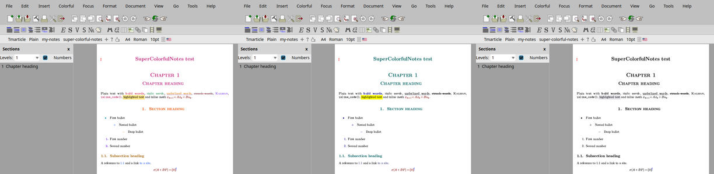
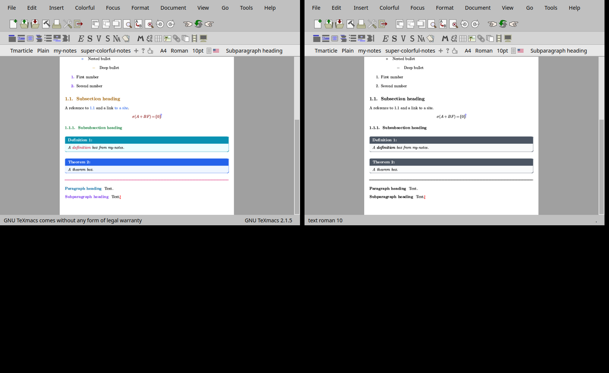

# SuperColorfulNotes

A GNU TeXmacs addon that colors your notes the way the Obsidian snippets
`colors.css`, `colorful-headings.css`, `colorful-links-tags.css` and
`code-syntax.css` color Markdown: red bold, green italic, orange underlined text
with a violet line, rainbow headings, colored bullets and numbers, blue links.
The more color, the more dopamine. One switch gives a serious, black and white
look, and PDF files can be exported with that look automatically.



Tested with TeXmacs 2.1.4 (Guile 3) and TeXmacs trunk 2.1.5 (Guile 1.8, Qt 5).

## What is colored

| Element | Default color (Obsidian light theme) |
|---|---|
| Bold (`strong`) | `#d9485f` |
| Italic (`em`) | `#148a4b` |
| Underlined text / its line | `#d97706` / `#7c3aed` |
| Struck out text / its line | `#6b7280` / `#b91c1c` |
| Names (small capitals) | `#7c3aed` |
| Inline code, verbatim, keys | `#be185d` |
| Highlighter (`marked`) | `#fde68a` |
| Document title, part, chapter | `#c0267d` |
| Section, subsection, subsubsection | `#ea580c`, `#a16207`, `#15803d` |
| Paragraph, subparagraph | `#0369a1`, `#7c3aed` |
| Bullets by level | `#0891b2`, `#2563eb`, `#ca8a04` |
| Numbers of enumerations (bold) | `#7c3aed` |
| Links and references | `#2563eb` |
| Mathematics | `dark red` (as with alt-colors) |
| Horizontal rules | `#db2777` |
| Brackets by nesting level | `#2563eb`, `#16a34a`, `#dc2626`, `#9333ea` |
| Dots of invisible multiplications | `#a0a0ff` |

Colored brackets and multiplication dots need a TeXmacs build with the
`math-bracket-colors` and `math-multiply-mark` variables (branch
`section-navigator` of [GliAcopo/texmacs](https://github.com/GliAcopo/texmacs),
see its `CHANGES_MADE_BY_US.md`). Other versions keep plain brackets and
invisible multiplications. In the serious look the brackets are plain and the
dots are shown on the screen only, not in the PDF.

The serious look has two styles (*Colorful → Serious look*):

- **Colors of the other packages** (the default): every element gets back
  exactly what the other packages of the document give it. With `alt-colors`
  the headings are teal again, bold text dark blue, math dark red, and the
  `my-notes` boxes keep their colors: the page is pixel for pixel the same as
  without SuperColorfulNotes.
- **Black and white**: everything is black, highlighted text is light grey,
  and the callout boxes of `my-notes` (definitions, theorems, warnings...) all
  become grey.

Turning off one family of elements (*What to color*) also gives it back what
the other packages give it.

## Living together with alt-colors

SuperColorfulNotes is meant to come after `alt-colors` in the list of
packages (the Colorful menu puts it last). In the colorful look it replaces
the colors of alt-colors for headings, bold text and list labels. alt-colors
also colors theorem names with `strong-color`: without `my-notes`, they turn
the bold color of SuperColorfulNotes (with `my-notes`, box titles stay white).
Math keeps the color of alt-colors by default (`dark red`). The rest of
alt-colors (framed and alternating colored blocks, blinking) is untouched.
Removing the package from a document with the Colorful menu also removes the
values it wrote in the document.

## Installation

```sh
git clone https://github.com/GliAcopo/texmacs-super-colorful-notes.git
ln -s "$PWD/texmacs-super-colorful-notes/super-colorful-notes" ~/.TeXmacs/plugins/super-colorful-notes
```

Restart TeXmacs. A **Colorful** menu appears in the menu bar. In a document,
choose *Colorful → Use SuperColorfulNotes in this document*: this adds the
style package `super-colorful-notes` at the end of the document's packages
(it is meant to come after `my-notes` and `alt-colors`).

## The Colorful menu

- **Colorful (off: serious look)**: switches the current document between the
  two looks.
- **What to color**: turns families of elements on or off (inline markup,
  headings, list labels, links, math, rules), and decides whether the
  callout boxes turn grey in the serious look.
- **Presets**: *Obsidian light* (the default), *Obsidian dark* (the exact dark
  theme colors of the snippets, on a dark page like Obsidian), *Neon dopamine*,
  *Ocean*.
- **Change colors**: a color picker for every element, including the colors of
  the serious look.
- **Reset to my default colors**: forgets the colors chosen for this document.
- **Color bold and italic made with the Format menu**: text made bold with
  *Format → Bold* is plain `with font-series bold`, which a style cannot
  recolor. This converts it, in the current document, to `strong` and `em`
  (it can be undone). Macro definitions are left alone.
- **Save as my defaults**: the colors of this document become the defaults of
  every document (written to
  `~/.TeXmacs/packages/super-colorful-notes-palette.ts`, which replaces the
  palette that comes with the addon). **Forget my defaults** removes that file.
- **Serious look in exported PDF files** (on by default): *File → Export as
  PDF* exports colorful documents with the serious look; the document itself
  stays colorful and is not marked as modified.
- **Export serious PDF**: the same for one export, whatever the setting.
- **Program code**: colors code blocks like `code-syntax.css` (light theme),
  or gives them the TeXmacs colors again. These are global preferences, used
  after restarting TeXmacs.

## Customizing by hand

Every color and switch is a variable of the style package, so it can also be
set in *Document → Source* or in the document's preamble, for instance
`<assign|scn-strong-color|#ff006e>` or `<assign|scn-headings|false>`. The
variables are listed in `packages/super-colorful-notes-palette.ts` and at the
top of `packages/super-colorful-notes.ts`. The switches are `scn-colorful`,
`scn-inline`, `scn-headings`, `scn-lists`, `scn-links`, `scn-math`, `scn-rules`,
`scn-brackets`, `scn-multiply` and `scn-serious-callouts`, and `scn-serious-style` is `previous` or `black`.

Links, math in displayed equations, bold text inside headings, brackets and
multiplication dots use plain TeXmacs variables (`locus-color`, `math-color`,
`strong-color`, `math-nesting-mode`, `math-bracket-colors`,
`math-multiply-mark`, `math-multiply-color`), which the
style can only set from the palette. The Colorful menu keeps them in step with
the document's colors, so use the menu rather than editing `scn-link-color`,
`scn-math-color` or `scn-strong-color` by hand.

## Development

This addon was developed with the assistance of Claude Opus 5.5, an AI model
by Anthropic, used through Claude Code. The design, the code and the tests
were reviewed and verified by the author on TeXmacs 2.1.4 and trunk: every
element in all three looks, the presets, the saved defaults, the colored
pixels of exported PDF files, and a pixel by pixel comparison showing that the
serious look with the colors of the other packages is identical to the
document without the addon.



## License

Copyright (C) 2026 Jacopo Rizzuto.

This program is free software: you can redistribute it and/or modify it under
the terms of the GNU General Public License as published by the Free Software
Foundation, either version 3 of the License, or (at your option) any later
version. See [LICENSE](LICENSE).
